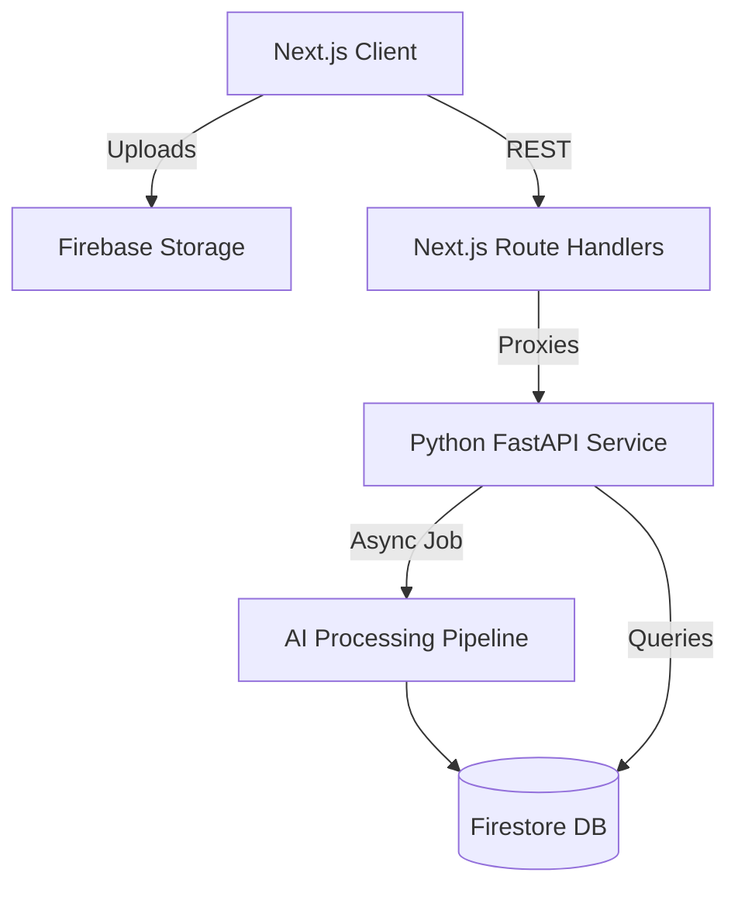

# CartSync AI

> Your Personal Fit Intelligence. 
> AI-powered body measurement and intelligent size recommendations in under 30 seconds.


CartSync AI is a premium consumer fashion platform designed to eliminate the frustration of guessing clothing sizes online. By combining computer vision (pose detection and depth estimation) with a robust recommendation engine, CartSync AI accurately maps human body measurements to brand-specific size charts, providing personalized, explainable product recommendations.

---

## 📸 Screenshots

*(Add screenshots here: Landing Page, Upload Flow, Fit Profile, AI Fit Report)*

---

## ✨ Features (v1.0)

### 🤖 AI Measurement Pipeline
- **Dual-Image Processing:** Extracts precise body topology from just a front and side photo.
- **Advanced Computer Vision:** Integrates MediaPipe for 33-point skeletal tracking and Depth Anything V2 for accurate 3D volume estimation.
- **Dynamic Calibration:** Adjusts for camera angle, lens distortion, and distance using the user's height as a baseline.
- **Quality Assessment Engine:** Prevents faulty recommendations by assessing lighting, blur, and occlusion before processing.

### 🧠 Intelligence Layer
- **Brand-Specific Sizing Engine:** Maps raw measurements against proprietary brand charts (e.g., Nike, Levi's, Zara).
- **Explainable Recommendations (Traces):** Users aren't just given a size; they receive human-readable explanations (e.g., *"Your chest and shoulder measurements align closely with this garment's sizing."*).
- **Product Ranking Engine:** Calculates an `AI Fit Score` (0-100%) by scoring how perfectly a garment matches a user's unique body distribution.
- **Outfit Generation:** Curates complete Pinterest-style looks based on complementary items and overall fit compatibility.

### 💎 Premium Frontend Experience
- **Cinematic Landing Page:** Dark luxury theme with storytelling and interactive 3D elements.
- **Mobile-First Glassmorphism UI:** Built for Gen Z shoppers, featuring fluid `framer-motion` micro-interactions, swipeable bottom sheets, and Apple Fitness style metric cards.
- **AI Fit Report:** A polished, shareable summary of the user's core dimensions, insights, and confidence metrics.
- **Product Comparison:** Side-by-side modal to compare fit scores, recommended sizes, and match quality across multiple products.

---

## 🏗️ Architecture

CartSync AI operates on a **BFF (Backend-For-Frontend)** architecture to ensure client-side performance and security.



---

## 🛠️ Tech Stack

**Frontend:**
- [Next.js](https://nextjs.org/) (React Framework)
- [Tailwind CSS](https://tailwindcss.com/) (Styling)
- [Framer Motion](https://www.framer.com/motion/) (Animations)
- [Lucide](https://lucide.dev/) (Icons)

**Backend:**
- [FastAPI](https://fastapi.tiangolo.com/) (Python API)
- [MediaPipe](https://developers.google.com/mediapipe) (Pose Estimation)
- [Depth Anything V2](https://github.com/DepthAnything/Depth-Anything-V2) (Monocular Depth)
- [Firebase Admin SDK](https://firebase.google.com/docs/admin/setup) (Database & Auth)

---

## 🚀 Getting Started

### 1. Prerequisites
- Node.js (v18+)
- Python (3.10+)
- Firebase Project with Firestore and Storage enabled.

### 2. Environment Variables
Create `.env.local` in the root directory:
```env
NEXT_PUBLIC_FIREBASE_API_KEY="your_api_key"
NEXT_PUBLIC_FIREBASE_PROJECT_ID="your_project_id"
# ... other standard Firebase web config variables
```

Create `.env` in the `python/` directory:
```env
FIREBASE_PROJECT_ID="your_project_id"
FIREBASE_CLIENT_EMAIL="your_service_account_email"
FIREBASE_PRIVATE_KEY="your_private_key"
```

### 3. Running the Backend (FastAPI)
```bash
cd python
python -m venv venv
source venv/bin/activate  # On Windows: venv\Scripts\activate
pip install -r requirements.txt
uvicorn api.main:app --reload --port 8000
```

### 4. Running the Frontend (Next.js)
```bash
# In the project root
npm install
npm run dev
```
Navigate to `http://localhost:3000` to view the application.

---

## 📂 Folder Structure

```text
├── src/
│   ├── app/                # Next.js App Router (Landing, Discover, API BFF)
│   ├── components/         # Reusable React UI (Glass cards, Overlays, Modals)
│   └── context/            # Global React State (Auth)
├── python/
│   ├── api/                # FastAPI Routes (/jobs, /dashboard)
│   ├── pipeline/           # AI Pipeline (Pose, Depth, Calibration)
│   ├── catalog/            # Intelligence Layer (Sizing, Ranking, Outfits)
│   └── workers/            # Background Task Managers
├── docs/                   # Internal architecture decisions and research
└── next.config.ts          # Next.js Config (Image optimization)
```

---

## 🗺️ Roadmap

- [x] **v1.0.0 (Public Beta):** Core AI pipeline, Catalog Intelligence, and Premium Frontend Experience.
- [ ] **v1.1.0:** Advanced feedback telemetry loops (automatically tuning brand size charts based on aggregate return data).
- [ ] **v1.2.0:** Parametric Body Model Generation (Phase 9).
- [ ] **v2.0.0:** Photorealistic Avatar & Virtual Try-On integration (Phase 10).

---

## 🤝 Contributing
CartSync AI is currently in closed beta. For access to the issue tracker or to submit a PR, please contact the repository administrators.

## 📄 License
Proprietary / Closed Source. All rights reserved.
